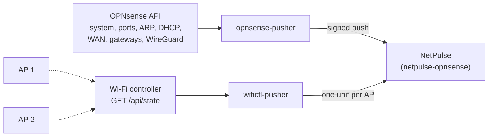

# netpulse-integrations

> [!NOTE]
> **n0deforge fork** of [gnacho/netpulse-integrations](https://github.com/gnacho/netpulse-integrations).
> The section below explains what it adds; everything after it is upstream's README.

## This fork: NetPulse with an OPNsense gateway

NetPulse is built around OpenWrt. It reads a router either by SSH, running
OpenWrt commands, or through its own agent installed on the router. A network
whose gateway is an **OPNsense firewall** and whose access points run **stock
vendor firmware** fits neither model. Upstream ships a beta OPNsense pusher
that covers the basics (system, interface counters, ARP), which leaves most of
the dashboard empty on such a network: devices without names, no WAN details,
no VLANs, no WireGuard and no access points at all.

This fork, together with the server fork
[netpulse-opnsense](https://github.com/n0deforge/netpulse-opnsense), fills
those gaps through the external-integration model NetPulse already defines:
vendor APIs are read here, and data reaches the server through the signed
ingestion endpoint.



### What changes on an OPNsense network

| Area | Upstream NetPulse | With this fork |
|---|---|---|
| Gateway health | CPU, memory, temperature, uptime, interface counters | Same, plus port names from the assigned interface and negotiated link speed |
| Devices | IPv4 ARP table; most devices unnamed | ARP, DHCP leases from Kea, dnsmasq or ISC, and the hostname OPNsense resolves for each ARP entry; offline devices stay known through their leases |
| WAN | Rates only when the interface is named by hand | WAN interface detected (PPPoE included), public IP, gateway, DNS, rates, and latency and loss from dpinger |
| VLANs and networks | None | Every assigned subnet as a named network with its VLAN tag; every device tagged with its VLAN, Wi-Fi clients included (server fork) |
| WireGuard | Not possible: the panel only reads OpenWrt over SSH | Peers, handshakes and transfer from the OPNsense API, with alerts and 30-day history (new payload section, server fork) |
| Access points | Not supported unless they run OpenWrt or a supported vendor firmware | `wifictl-pusher`: each AP managed by a self-hosted controller becomes a unit with board, firmware, uptime, radios, clients, signal and ping |
| Topology | One live map | Live, wired, Wi-Fi, per-VLAN and per-AP views (server fork) |
| 24 h WAN total | About 24x too high on a fresh install | Fixed (server fork) |
| Install | Binary and systemd | Also a Docker stack with env examples and a helper that creates units and tokens |

### What was built

- **`opnsense/`**, extended (all additions are best effort: a missing plugin or
  privilege drops that section without failing the push):
  - DHCP leases from all three DHCP servers OPNsense ships, merged by MAC
  - interface overview: WAN autodetection, port labels and speeds, interface
    MACs so the firewall is never drawn as a client
  - device names from the ARP table hostname
  - WAN latency and loss from gateway monitoring
  - networks (name, subnet, VLAN tag) and the VLAN of every ARP entry
  - WireGuard peers into the new `wireguard` payload section
- **`wifictl/`**, new: reads a self-hosted Wi-Fi controller and pushes one
  unit per access point. Built for a T18-21K Pro and an ASUS in AP mode,
  neither of which NetPulse could read before.
- **`deploy/docker/`**, new: NetPulse plus both pushers in one compose file,
  env examples, a setup guide written from a real install (including the
  OPNsense firewall rule and the GUI listen-interface catch) and
  `register.sh`, which creates external units and agent tokens and prints
  certificate fingerprints.
- **Release plumbing**: `wifictl` is registered in `vendors.json` and the
  release workflow like every upstream integration, CI builds both pushers,
  and a workflow publishes the pushers image to GHCR.

### Validation

Run against a real network, not only fixtures: OPNsense 26.1.11 with PPPoE
WAN, six VLANs, dnsmasq DHCP (42 leases) and a WireGuard client tunnel; a
T18-21K Pro and an ASUS RT-AC68U in AP mode behind the controller. Every API
response shape was checked against the parsers before release, and each
addition has tests. Per-integration details are in
[opnsense/README.md](opnsense/README.md) and [wifictl/README.md](wifictl/README.md).

### Getting started

Follow [deploy/docker](deploy/docker). In short:

```sh
cd deploy/docker
cp netpulse.env.example netpulse.env          # set AUTH_PASS
docker compose up -d netpulse
./register.sh unit OPNsense 192.168.1.1 gateway
cp opnsense.env.example opnsense.env           # API key, token, cert pin
docker compose --profile opnsense up -d
```

### Releases and branches

| | |
|---|---|
| `main` | Untouched mirror of upstream |
| `opnsense` | Default branch: upstream plus this fork's commits |
| `opnsense/vX.Y.Z-n0de.N` | OPNsense pusher releases (fork of an upstream integration) |
| `wifictl/vX.Y.Z` | Wi-Fi controller pusher releases |
| `ghcr.io/n0deforge/netpulse-integrations-opnsense` | Image with both pushers |

Each release has amd64 and arm64 binaries with checksums and notes taken from
the integration's CHANGELOG.

### Relationship with upstream

Integrations unchanged from upstream (RouterOS, Asuswrt, Bbox, FN, UniFi)
should be reported and improved at
[gnacho/netpulse-integrations](https://github.com/gnacho/netpulse-integrations).
The OPNsense additions follow upstream's contribution rules (read-only,
fixtures, honest absence of data) so they can be offered back.

---

External agents for router families that do not belong in the NetPulse core.

NetPulse supports two router sources in its own code: the native OpenWrt agent and generic SNMP. Vendor APIs, credentials and firmware quirks live here instead, one directory per family. A small supervisor runs one or more vendor pollers and sends signed data to `POST /api/ingest/agent`.

This keeps the NetPulse server small and avoids shipping code for hardware the core maintainers cannot test. An integration can be released on its own schedule without forcing every NetPulse user to carry it.

## Integrations

| Directory | Transport | Coverage |
|---|---|---|
| `routeros/` | RouterOS binary API on port 8728, REST fallback | RouterOS 7+: system, Ethernet ports, DHCP, ARP, bridge FDB, temperature, flash, firmware state and WAN rates |
| `bbox/` | Bbox local HTTPS API | System, WAN, active hosts and Ethernet port rates |
| `opnsense/` | OPNsense HTTPS API, read-only, **beta** | System, interface counters announced as ports, IPv4 ARP, WAN rates with an explicitly selected interface, per-client traffic, memory, the hottest temperature sensor, uptime, load average and CPU usage. Validated against OPNsense 26.7 in a VM and on a user unit. *Fork:* DHCP leases, WAN and interface details, ARP hostnames and WireGuard peers, validated against OPNsense 26.1.11 |
| `asuswrt/` | Local Asuswrt/Merlin probes | System, wireless, DHCP, ARP, FDB, LLDP, interfaces and WAN data exposed by the firmware |
| `unifi/` | UniFi controller REST API, read-only | Gateways, switches and APs of one site: FDB ports and uplink attachments, wireless clients, ARP identities and gateway uptime |
| `wifictl/` | Self-hosted Wi-Fi controller REST API, read-only, **fork** | One unit per managed AP: board, firmware, uptime, controller ping, one radio per band (channel, width, clients) and associated clients with band and signal. Validated with a T18-21K Pro and an ASUS RT-AC68U in AP mode |
| `fn/` | Switch web JSON backend (`/cgi/get.cgi?cmd=...`) plus its SSH CLI | Realtek RTL930x SDK managed switches (FN SWITCH 8 PRO and siblings): CPU load, port speeds, octet counters, FDB, LLDP neighbors, model, firmware, uptime; fan temperature and memory bytes from the CLI |

All integrations are read-only: they read router data and do not change
configuration or install or upgrade firmware.

## Vendor catalog

[`vendors.json`](vendors.json) is the machine-readable catalog NetPulse core
fetches to discover integrations, so adding a vendor never requires a NetPulse
release. It holds one entry per vendor directory and CI keeps it in sync with
the repository: `.github/validate_vendors.py` (stdlib only) runs on every push
and pull request and fails on drift between the catalog, the vendor
directories and the release workflow.

| Field | Meaning |
|---|---|
| `id` | Vendor directory name: lowercase, unique, entries sorted by it |
| `mode` | How NetPulse runs the agent: `local` (managed child on the NetPulse host) or `ssh` (installed on the router itself) |
| `arches` | Linux architectures the release workflow builds for this vendor |
| `tagPrefix` | Release tag prefix, `<id>/v`; the workflow listens on `<tagPrefix>*` tags |
| `binary` | Name of the published binary for this vendor |
| `target` | Go build target directory (`<target>/main.go`) compiled for the tag |
| `description` | One-line summary shown by NetPulse |

## Why a separate repository

- **Different lifecycles.** Router integrations follow vendor firmware releases,
  not NetPulse releases.
- **Isolated credentials.** Router passwords and API tokens stay inside the
  integration config, never in the NetPulse server.
- **Hardware-specific ownership.** Each integration has its own maintainer,
  who can validate it on supported hardware.

## Docker (fork)

[`deploy/docker`](deploy/docker) has a compose file for NetPulse plus the
OPNsense and Wi-Fi controller pushers, env examples and a `register.sh` helper
that creates the external units and their tokens. Follow its README; the rest
of this section is the upstream binary install.

## Install

Build the shared supervisor. It runs configured vendor pollers in one process
and does not require Docker. The Asuswrt poller uses local shell probes, so the
supervisor must run on the Asuswrt/Merlin device when that integration is
configured.

```sh
go build -trimpath -o netpulse-integrations ./cmd/integrations-supervisor
```

Create each router in NetPulse as type `external`, obtain its agent token and
add its vendor connection details to the supervisor JSON config. Keep the
config readable only by the service account; it contains passwords and agent
tokens. Install the shared unit from
[`deploy/netpulse-integrations.service`](deploy/netpulse-integrations.service).

The supervisor accepts multiple vendor entries in one JSON config. Each
integration keeps its own directory, poller and documentation while sharing
the process, service unit and update path.

The server trust settings apply to every supervisor integration. Use the
root-level `server_fp` for NetPulse's self-signed HTTPS certificate or when
the certificate name does not match the server URL; use `ca_file` for a
private CA when the certificate name matches. Configure one or the other.
Standalone pushers use the same delivery client and accept the equivalent
`NETPULSE_SERVER_FP` or `NETPULSE_CA_FILE` environment variable.

A fingerprint is the SHA-256 SPKI hash of the certificate the server presents,
which is normally the leaf. Pinning a CA only matches a CA that the server
actually sends in its chain, so a pin computed from a root CA fails when the
server omits that root, as most servers do. The failure is an ordinary TLS
verification error, with no hint that the pin format is the problem.

The delivery client follows a redirect only when it stays on the same scheme,
host and port, and only when the request keeps its POST method and body, which
in practice means 307 and 308. A 301, 302 or 303 is refused with an explicit
error because the ingest endpoint accepts only a signed POST, and a redirect to
another origin is always refused so the token and the signature never leave the
configured server.

Every push is a signed HTTP request to `POST /api/ingest/agent`. The ingest
contract, authentication, payload semantics and contribution rules are in the
NetPulse guide:

https://github.com/gnacho/netpulse/blob/main/docs/external-integrations.md

## Development

Go 1.26 or newer.

```sh
gofmt -l .
go vet ./...
go test ./...
```

CI runs the same checks, race-enabled tests and static builds for every pull
request. Tags such as `routeros/v0.1.0` and `asuswrt/v0.1.0` run the tests and
publish a static Linux binary tarball with its SHA-256 file. RouterOS releases
currently target amd64 and Asuswrt releases target ARM64. Tags for integrations
running under the supervisor publish the supervisor binary for amd64 and
arm64.

## Adding an integration

1. Open an issue in the NetPulse repository with the router model, firmware, API documentation, available data and a read-only first scope.
2. Add a directory named after the family, with `README.md` and `CHANGELOG.md`; keep its poller and vendor-specific details inside that directory.
3. Add a poller constructor to the shared supervisor. Keep vendor credentials and parsing inside that directory. Ask NetPulse maintainers for neutral contract fields before depending on them.
4. Include fixtures and tests. Real-hardware evidence is required before stable support; a docs-based beta must say so explicitly and list its unverified behavior.
5. Add a `CODEOWNERS` entry for the directory. The owner of the hardware maintains it and validates releases.
6. Add an entry to [`vendors.json`](vendors.json) with the release values and a short description. CI validates the catalog against the release workflow and fails on drift.
7. Tag releases per integration, for example `routeros/v0.1.0`. The release workflow tests the repository and publishes the documented platform asset. Validate the integration on real hardware before calling it stable. A beta tag for community validation must be labeled beta in the catalog and documentation, with its limitations and evidence gaps stated.

The maintainer of this repository decides who owns each directory. Directory ownership is not transferred by sending a pull request.

## Links

- NetPulse dashboard: https://netpulse.cloudless.club/
- NetPulse source: https://github.com/gnacho/netpulse
- Live demo: https://demo.netpulse.cloudless.club/

## License

GNU Affero General Public License v3.0. See `LICENSE`.
